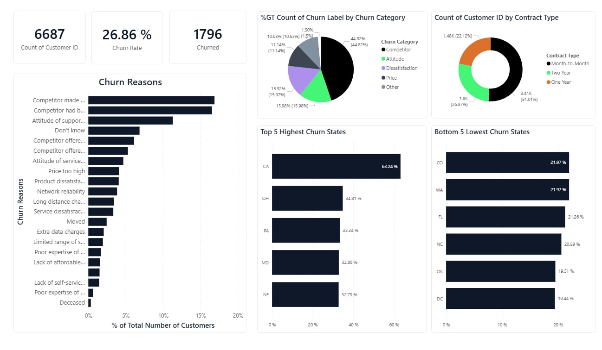
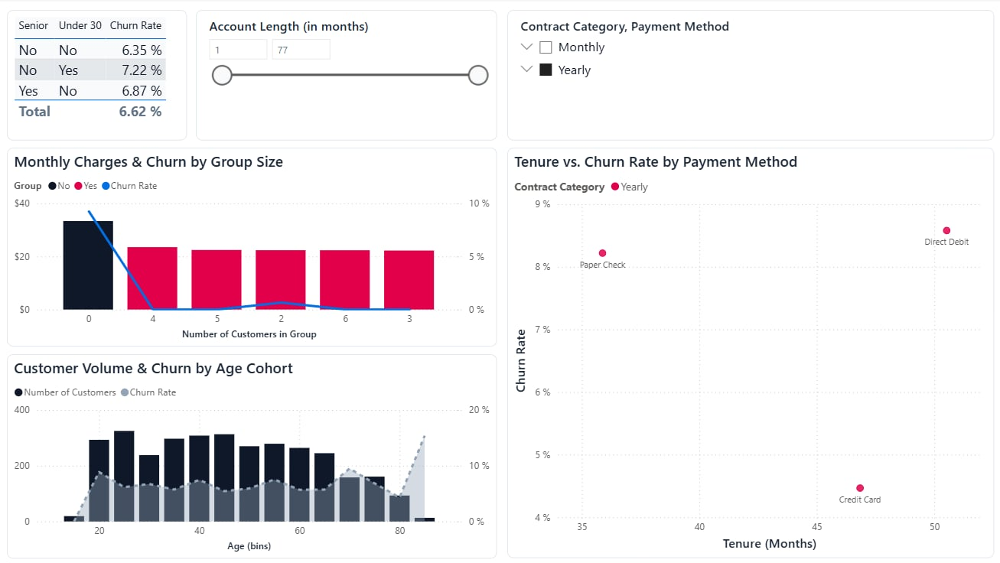
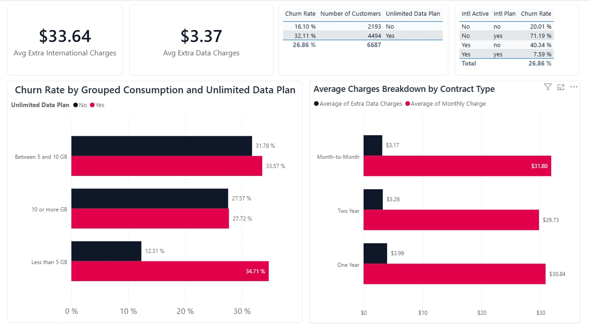
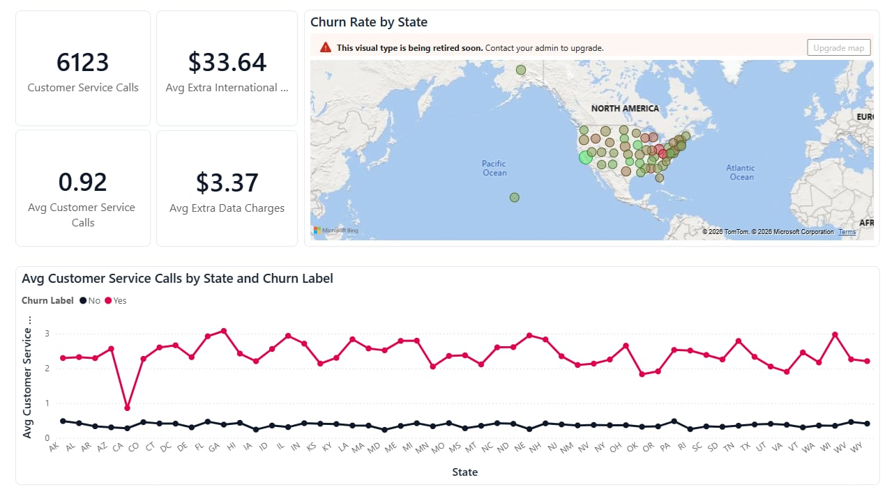

# 📊 Analyzing Telecom Customer Churn | DataCamp Case Study

> An end-to-end business intelligence case study analyzing customer attrition patterns for **Databel**, a telecom provider. Built with Microsoft Power BI to uncover root causes of customer churn, model subscriber behavior, and deliver data-driven retention strategies to leadership.

---

## 🖼️ Dashboard Showcase

| 1. Executive Summary & Churn Drivers | 2. Demographics & Customer Tenure |
| :---: | :---: |
|  |  |

| 3. Plans, Consumption & Extra Charges | 4. Geographic Risk & Service Operations |
| :---: | :---: |
|  |  |

---

## 📌 Executive Summary & Key KPIs

Across a snapshot dataset of **6,687 customers**, Databel recorded an overall attrition rate of **26.86% (1,796 churned customers)**.

| Metric | Value | Business Takeaway |
| :--- | :---: | :--- |
| **Total Customers** | **6,687** | Full snapshot of active and churned customer accounts |
| **Churned Customers** | **1,796** | Total customer volume lost |
| **Overall Churn Rate** | **26.86%** | Benchmark baseline attrition across all segments |
| **Month-to-Month Churn** | **46.29%** | Accounted for ~89% of all churned customers (~1,580 users) |
| **Two-Year Contract Churn** | **2.78%** | Long-term contracts achieve strong retention |
| **Total Service Calls** | **6,123** | Churned users averaged ~2.5–3.0 calls vs. <0.5 calls for retained users |

---

## 🔍 Key Business Insights

### 1. Contract Type is the Primary Churn Driver
- **Month-to-Month contracts** experience a **46.29% churn rate**, representing over half (51%) of Databel's subscriber base.
- In contrast, customers on **One-Year (13%)** and **Two-Year (2.78%)** contracts show significantly lower churn, highlighting contract lock-in as an effective retention lever.

### 2. Competitor Pressure & Pricing Disconnect
- **44.8% of all churn** is directly attributed to **Competitors** (competitor had better devices, made better offers, or provided faster download speeds).
- Dissatisfaction, support attitude, and pricing transparency represent secondary drivers.

### 3. Senior Demographic Vulnerability
- Senior citizens experience a **38.46% churn rate**, compared to **23.00% for under-30 subscribers** and **24.54% for non-senior adults**.

### 4. International & Unlimited Plan Inefficiencies
- **Under-consumption in Unlimited Plans:** Customers with unlimited data plans who use **less than 5 GB** churn at **34.7%**, compared to **12.3%** for non-unlimited users in the same usage bracket—suggesting customers feel they are paying for unused allowances.
- Customers with active international plans but low international usage exhibit disproportionately higher churn.

### 5. Service & Support Touchpoints
- Retained customers average fewer than **0.5 support calls**, while churned customers average between **2.0 and 3.0 calls**, signaling that unresolved customer service tickets directly precede churn.

---

## 🛠️ Data Analysis Flow & Architecture

The project followed a 5-stage analytical lifecycle:

```text
1. Data Check & Validation
   ├── Evaluated 29 customer attributes (Customer ID, demographics, charges, contracts)
   └── Validated data integrity, missing values, and duplicate records

2. Data Exploration & Modeling
   ├── Developed calculated columns and DAX measures for churn metrics
   └── Grouped continuous variables (Age bins, consumption tiers, tenure segments)

3. Deep-Dive Visualization
   ├── Decomposition of churn by category, geography, plan types, and tenure
   └── Comparative multi-axis charts combining volume counts with churn rates

4. Dashboard Architecture
   ├── Summary KPI cards, interactive cross-filtering, and slicing
   └── Topic-specific report pages: Overview, Demographics, Contracts, and Extra Charges

5. Strategic Stakeholder Recommendations
   └── Translating data patterns into actionable commercial initiatives
